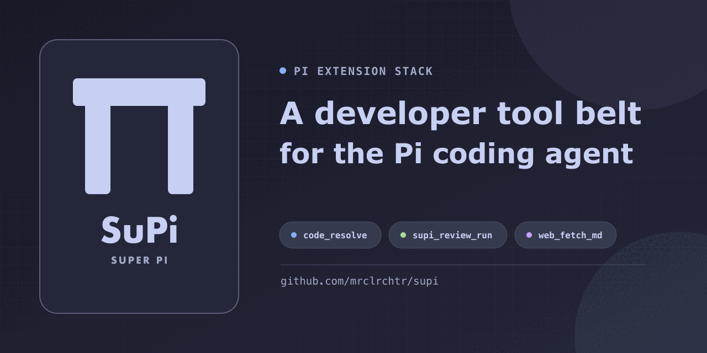

# SuPi — Extension Stack for the Pi Coding Agent

[](https://github.com/mrclrchtr/supi/stargazers)
[](LICENSE)
[](https://twitter.com/intent/tweet?text=SuPi%20is%20an%20open-source%20extension%20stack%20for%20the%20Pi%20coding%20agent%3A%20LSP%20%2B%20Tree-sitter%20code%20intelligence%2C%20semantic%20refactoring%2C%20code%20review%2C%20web%20docs%2C%20and%20more&url=https%3A%2F%2Fgithub.com%2Fmrclrchtr%2Fsupi&hashtags=pi,codingagent)

SuPi (short for **Super Pi**) is an open-source TypeScript extension stack for the [Pi coding agent](https://github.com/earendil-works/pi). It adds LSP and Tree-sitter code intelligence, semantic refactoring, parallel code review, web and Context7 documentation access, structured ask-user forms, scoped skill controls, quick skill input, and context/session observability.

Install the recommended stack or pick only the packages you need. You keep prompting Pi normally; SuPi gives the agent additional tools and context it can use directly.

**If SuPi helps you, [give the repository a star on GitHub](https://github.com/mrclrchtr/supi/stargazers). Stars help other Pi users find the project.**

> SuPi is pre-release. Packages marked beta are the fastest-moving parts of the stack.

## The key difference: LSP + AST for the agent

Most coding agents can read files and search text. [`@mrclrchtr/supi-code-intelligence`](packages/supi-code-intelligence/README.md) gives Pi direct, model-callable access to two complementary sources of code intelligence:

- **Language servers (LSP)** provide types, definitions, references, implementations, diagnostics, workspace symbols, and semantic refactoring.
- **Tree-sitter ASTs** provide syntax, outlines, source structure, structural search, and outgoing calls.

The agent receives focused `code_*` tools for workspace orientation, precise symbol inspection, relationship analysis, code-aware search, live health, and safe refactor previews. Results disclose their evidence and say when semantic or structural analysis is unavailable instead of silently guessing. Workspace navigation can also include [consent-gated Gradle 9 build structure](packages/supi-code-intelligence/README.md#consent-gated-gradle-observations), separately authorized behind Pi project trust.

Tree-sitter support is bundled. Full LSP features require the matching language-server binary on `PATH`; see the [Code Intelligence setup and screenshots](packages/supi-code-intelligence/README.md#language-support).

[![Code Intelligence showing LSP references and AST calls][code-intelligence]][code-intelligence]

[See all Code Intelligence screenshots →](packages/supi-code-intelligence/README.md#see-it-in-action)

## What else your agent gets

- **Web access built for agents** — [`supi-web`](packages/supi-web/README.md) prefers source Markdown, extracts readable content from public HTML, fences plain-text files, and moves long pages to temporary files instead of flooding the context window.
- **Focused library docs** — search Context7 for the right project and version, then retrieve documentation narrowed to the current task.
- **Structured decisions** — ask you focused choice or text questions through a keyboard-driven form with [`supi-ask-user`](packages/supi-ask-user/README.md).
- **Review workflows** — run independent, inspection-only reviews of exact Git targets with [`supi-review`](packages/supi-review/README.md).
- **Agent Profile policy** — discover explicit `explore` and `general` profiles with bounded resource envelopes through [`supi-agent`](packages/supi-agent/README.md).
- **Operational awareness** — inspect context pressure, cache history and forensics, and SuPi debug events with `supi-context`, `supi-cache`, and `supi-debug`. PI owns live cache statistics and cache-miss notices.
- **Repository guidance** — maintain `CLAUDE.md` and `AGENTS.md` files with the skills in [`supi-claude-md`](packages/supi-claude-md/README.md).
- **Skills on your terms** — use [`supi-skills`](packages/supi-skills/README.md) to choose, globally or per project, whether Pi can select each skill automatically, whether only you can start it, or whether it is disabled. Type `$` to search and start installed skills without remembering their full command names.
- **Session polish** — use [`supi-extras`](packages/supi-extras/README.md) to choose session-only tool visibility and, with `supi-skills`, skill visibility. It also adds prompt stashing, activity indicators, and shortcuts.

## Install

After any installation, run `/reload` or restart Pi.

### Select packages and scopes

Install PI and make sure `pi` is on `PATH`. Open PI in the target project and use `/trust` to save project approval. Then run the [SuPi installer](packages/supi-installer/README.md):

```sh
npx @mrclrchtr/supi-installer@latest
```

Each package row has **Project** and **Global** checkboxes. They represent direct declarations in those scopes, not whether a capability is active. Choose packages, press Enter to review additions and removals, then press `y` to confirm.

- `r`: replace the focused column with the Recommended release stack.
- `a`: select All current packages in that column, including beta packages, DevTools, Consulting, and Prompt Improver.
- `c`: clear editable declarations in that column.

To target another project directory:

```sh
npx @mrclrchtr/supi-installer@latest --project /path/to/project
```

The installer requires saved project trust even for global-only work. It never grants trust or installs PI. Clearing Project does not disable a global declaration. Removal keeps user data. If a scope move fails, source removal can still run; review the failure warning before confirmation.

> PI extensions run with your user permissions. Review packages before installing them.

### One package

Every extension package is independently installable:

```bash
pi install npm:@mrclrchtr/supi-code-intelligence
```

```bash
pi install npm:@mrclrchtr/supi-web
```

## Package catalog

### Release stack

| Package | What it adds | Install |
|---|---|---|
| [`supi-code-intelligence`](packages/supi-code-intelligence/README.md) | Direct LSP- and AST-backed code understanding, navigation, search, health, and refactoring tools | `pi install npm:@mrclrchtr/supi-code-intelligence` |
| [`supi-web`](packages/supi-web/README.md) | Public-page-to-Markdown fetching, public web source search, context-safe large output, and focused Context7 documentation | `pi install npm:@mrclrchtr/supi-web` |
| [`supi-ask-user`](packages/supi-ask-user/README.md) | Structured choice and text forms for focused agent-user decisions | `pi install npm:@mrclrchtr/supi-ask-user` |
| [`supi-context`](packages/supi-context/README.md) | Context-pressure snapshots and detailed TUI usage reports | `pi install npm:@mrclrchtr/supi-context` |
| [`supi-settings`](packages/supi-settings/README.md) | One project/global settings UI for SuPi packages | `pi install npm:@mrclrchtr/supi-settings` |
| [`supi-skills`](packages/supi-skills/README.md) | Scoped skill controls and `$skill-name` input shortcuts | `pi install npm:@mrclrchtr/supi-skills` |
| [`supi-extras`](packages/supi-extras/README.md) | Session capability controls, prompt stash, shortcuts, and activity indicators | `pi install npm:@mrclrchtr/supi-extras` |
| [`supi-prompt-suggestions`](packages/supi-prompt-suggestions/README.md) | Advisory ghost-text suggestions from a model you choose | `pi install npm:@mrclrchtr/supi-prompt-suggestions` |

### Adapted skills

The root [`skills/`](skills) catalog contains patched SuPi-compatible editions of third-party skills and SuPi-owned skills. Install only the skills you need:

```bash
npx skills add mrclrchtr/supi --skill code-review commit
```

[`supi-skill-patches`](packages/supi-skill-patches/README.md) is the private maintenance workspace that synchronizes and validates this catalog.

### DevTools

Not part of the Recommended release stack. Select these packages individually, use All in the installer, or install them separately:

| Package | What it adds | Install |
|---|---|---|
| [`supi-debug`](packages/supi-debug/README.md) | Debug-event capture, troubleshooting tools, and post-task tooling feedback via `/supi-tooling-retro` | `pi install npm:@mrclrchtr/supi-debug` |

### Beta additions

Select beta packages individually or use All in the installer. Consulting is opt-in and is not part of Recommended:

| Package | What it adds | Install |
|---|---|---|
| [`supi-review`](packages/supi-review/README.md) | Caller-defined, inspection-only reviews in managed child sessions | `pi install npm:@mrclrchtr/supi-review` |
| [`supi-agent`](packages/supi-agent/README.md) | Explicit Agent Profile catalogue and child resource policy | `pi install npm:@mrclrchtr/supi-agent` |
| [`supi-consulting`](packages/supi-consulting/README.md) | **Agent** — bounded consultations with explicit agent and workspace selection and observed evidence; currently supports Antigravity | `pi install npm:@mrclrchtr/supi-consulting` |
| [`supi-cache`](packages/supi-cache/README.md) | Prompt-cache history and cross-session regression forensics | `pi install npm:@mrclrchtr/supi-cache` |
| [`supi-insights`](packages/supi-insights/README.md) | Historical session analytics and shareable HTML reports | `pi install npm:@mrclrchtr/supi-insights` |
| [`supi-claude-md`](packages/supi-claude-md/README.md) | Skills for auditing and revising repository instruction files | `pi install npm:@mrclrchtr/supi-claude-md` |
| [`supi-bash-timeout`](packages/supi-bash-timeout/README.md) | Default timeouts so forgotten shell limits do not stall the session | `pi install npm:@mrclrchtr/supi-bash-timeout` |

### Additional package

- [`supi-prompt-improver`](packages/supi-prompt-improver/README.md) — command-based prompt improvement with user-approved drafts. Select it in the installer or run `pi install npm:@mrclrchtr/supi-prompt-improver`.

### Internal libraries

These packages power the stack and are not standalone Pi extensions:

- [`supi-lsp`](packages/supi-lsp/README.md) — Language Server Protocol runtime bundled by Code Intelligence.
- [`supi-tree-sitter`](packages/supi-tree-sitter/README.md) — structural AST analysis bundled by Code Intelligence.
- [`supi-code-runtime`](packages/supi-code-runtime/README.md) — shared code-intelligence contracts and workspace capability state.
- [`supi-agent-runtime`](packages/supi-agent-runtime/README.md) — neutral in-memory Agent Run lifecycle, usage accounting, and bounded diagnostics for extension-owned adapters.
- [`supi-core`](packages/supi-core/README.md) — common configuration, settings, reporting, and session infrastructure.
- [`supi-test-utils`](packages/supi-test-utils/README.md) — shared test helpers for SuPi packages.

## Configure

The release stack includes [`supi-settings`](packages/supi-settings/README.md). Open the shared settings UI with:

```text
/supi-settings
```

Press Tab to switch between project and global scope. Settings show whether each value comes from the project, global configuration, or its default.

### Control skills

[`supi-skills`](packages/supi-skills/README.md) adds a searchable **Skills** section to `/supi-settings`. Each installed skill can be:

- **Enabled** — Pi can select the skill automatically, and you can start it explicitly.
- **Model invocation disabled** — only you can start the skill explicitly.
- **Disabled** — Pi does not load the skill or its command.

At the prompt, type `$` and part of a skill name. Select a result to insert `$skill-name`; SuPi runs it as `/skill:skill-name` when you submit. For example, if `code-review` is installed:

```text
$code-review Review the current changes.
```

Project choices inherit your global choices. Run `/reload` after you change whether a skill loads, or after you add or remove skills. Install `supi-extras` to hide model-visible skills for one session. This does not change explicit skill commands or `$skill-name` shortcuts.

The Recommended preset includes both `supi-skills` and `supi-settings`. For a standalone installation with skill controls, install both packages:

```bash
pi install npm:@mrclrchtr/supi-settings
pi install npm:@mrclrchtr/supi-skills
```

Install `@mrclrchtr/supi-extras` to manage session-only skill visibility with `/supi-capabilities`.

## Update and remove

Update installed Pi packages:

```bash
pi update --extensions
```

To remove selected SuPi packages, open the installer and clear their scope checkboxes. Use `c` to clear the focused column, then review and confirm:

```sh
npx @mrclrchtr/supi-installer@latest
```

Unknown sources remain unchanged. Recognized Git/local or legacy root installs need manual removal through PI. The old shell installer commands have been retired.

Remove one package:

```bash
pi uninstall npm:@mrclrchtr/supi-web
```

Run `/reload` or restart Pi after removing extensions.

## Give feedback

SuPi improves with your feedback. After a task, run `/supi-tooling-retro` to produce a compact retrospective of the SuPi surfaces you used — what helped, what fell short, what was missing, and what was noisy. This prompt template ships with the `supi-debug` DevTool package:

```bash
pi install npm:@mrclrchtr/supi-debug
```

Share the result, or any friction you find in SuPi tools, prompts, skills, or injected context, as a [GitHub issue](https://github.com/mrclrchtr/supi/issues).

If SuPi is useful to you, consider giving it a [star](https://github.com/mrclrchtr/supi/stargazers) as well.

## License

[MIT](LICENSE)

[code-intelligence]: https://raw.githubusercontent.com/mrclrchtr/supi/main/packages/supi-code-intelligence/assets/relationship-graph.png
