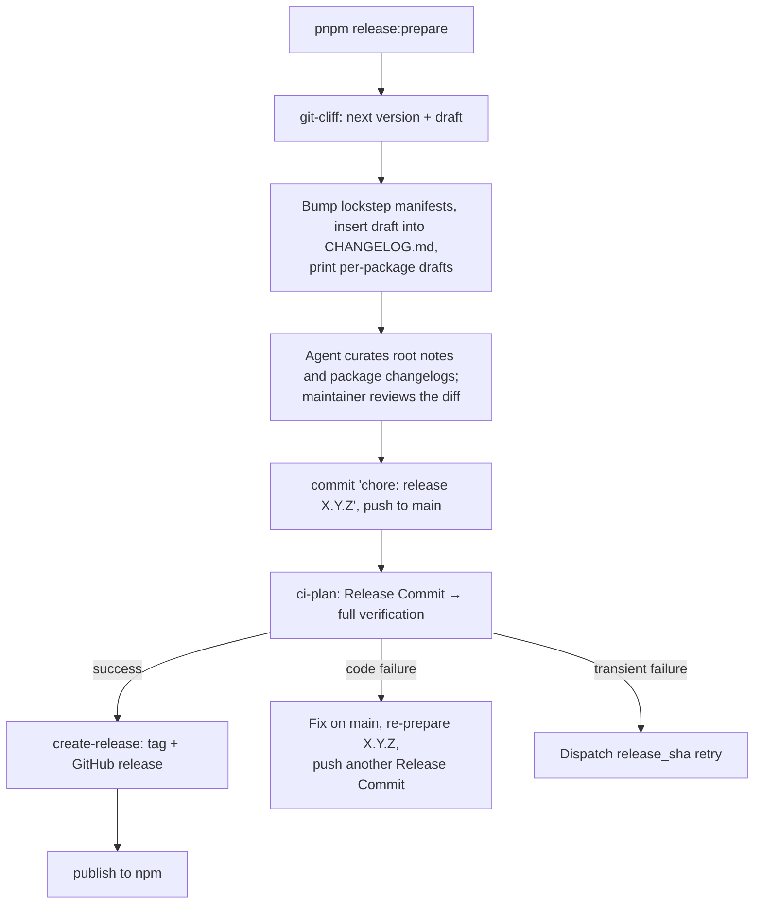

# Release preparation

## Status

Implemented. Replaces Release Please. CI gates and retries are in [CI and release gates](ci-verification.md); the agent workflow is the user-invoked `release` skill (`.pi/skills/release/SKILL.md`).

## Why

- Release Please rebuilt its release PR on every main push, so edited SuPi Release Notes were lost.
- A merged release PR that failed exhaustive verification was a dead end: fixes on main never reached the merged release commit, and Release Please refused new PRs while the old one kept `autorelease: pending` (11.4.0, PR #574).
- SuPi already owned verification, tagging, GitHub release creation, and publishing.

## Decisions

| Concern | Decision |
| --- | --- |
| Development model | Trunk-based. A release is a **Release Commit** on `main`, pushed directly or merged through a PR as the tip commit with its exact subject (rebase merge, or squash titled exactly `chore: release X.Y.Z`). No release branch or bot PR. |
| Trigger | Manual and local: `pnpm release:prepare [--version X.Y.Z]`. |
| Draft source | [git-cliff](https://git-cliff.org) (`cliff.toml`) computes the next version and drafts notes from Conventional Commits since the last `vX.Y.Z` tag. Only `feat`, `fix`, `perf`, `revert`, and breaking changes appear. |
| Editorial step | An agent curates the draft and package changelogs in the working tree; the maintainer reviews the diff. Nothing regenerates notes after preparation. |
| Preparation output | Non-interactive Markdown on stdout: version, commit range, changed files, root draft, per-package drafts, next steps. No editor, no prompts. |
| Published notes | The first `CHANGELOG.md` section at the verified Release Commit becomes the GitHub release body. |
| Version identity | Root `package.json#version`. One shared version and one `vX.Y.Z` tag. |
| Lockstep packages | Root plus every non-private `packages/*/package.json`, derived at preparation time. |
| Version consumption | A version is consumed only by its tag. An untagged version can be re-prepared. |
| Tool installation | `git-cliff` root `devDependency`, pinned by the lockfile. Only local preparation runs it. |

## Release Commit

A commit on `main` is a Release Commit when:

- its subject is exactly `chore: release X.Y.Z`;
- root `package.json#version` is `X.Y.Z`;
- the first `CHANGELOG.md` section heading is `X.Y.Z` with nonempty notes.

CI treats a pushed tip starting with `chore: release` that breaks the other rules (including `chore: release X.Y.Z (#N)`) as a planning failure, not an ordinary push. Tag `vX.Y.Z` must be absent or already point at the candidate, and no later first-parent Release Commit for the same version may exist. Rules live in [`scripts/release-candidate.mjs`](../../scripts/release-candidate.mjs).

## Workflow

### `pnpm release:prepare`

[`scripts/release-prepare.mjs`](../../scripts/release-prepare.mjs) changes only the working tree and never commits, tags, or pushes.

1. Requires a clean working tree on `main` that matches `origin/main`.
2. Selects the version: `--version`, else the root version if it is untagged and newer than the latest tag (re-prepare), else `git cliff --bumped-version`. Rejects tagged, non-increasing, and prerelease versions, and fails when no release-relevant commits exist. When `CHANGELOG.md` starts with a different untagged version, it fails and asks to rename that heading, so curated notes are never stacked under two versions.
3. New version: inserts the git-cliff draft as the first `CHANGELOG.md` section; fails without changing files when no release-relevant commits exist.
4. Re-prepare: keeps the existing first section and prints only commits after the previous `chore: release X.Y.Z` commit.
5. Sets `version` in all lockstep manifests.
6. Prints per-package drafts from `git cliff --include-path packages/<pkg>/**` for public Extension Packages, always covering every commit since the latest tag. It never writes package changelogs; the [package changelog convention](package-changelogs.md) forbids synthesized notes.

## Recovery

| Failure | Action |
| --- | --- |
| Verification fails because of code | Fix on `main`, run `pnpm release:prepare` (re-prepares `X.Y.Z`), add notes for new commits, commit `chore: release X.Y.Z` again (`--allow-empty` when nothing changed), push. The newest Release Commit becomes the candidate; CI rejects earlier ones for the same version. |
| Transient failure (runner, network) | Re-run failed jobs, or `gh workflow run ci.yml --ref main -f release_sha=<sha>`. |
| Tag exists, release or publish missing | `release_sha` retry finishes the release; `publish_tag` retries npm only. |

Never move or delete a tag. A tagged version is consumed; prepare a newer one.

## Changing generated notes

Edit `cliff.toml` for grouping, formatting, or filtered commit types. It keeps the historical root changelog shape: `## [X.Y.Z](compare) (date)`, `### ⚠ BREAKING CHANGES`, typed sections, `**scope:**` prefixes, short-SHA commit links, and `closes #N` links.
