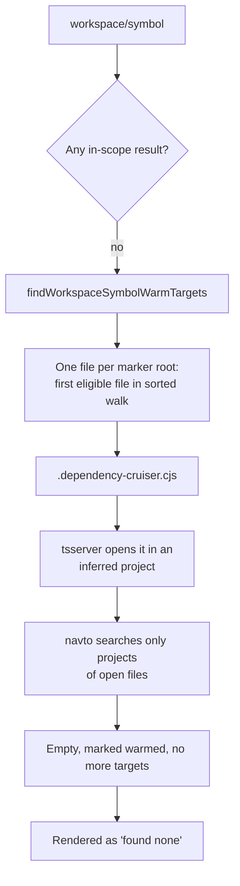

# Semantic search returns a confident empty result before a project file is open

**Status:** fixed in `supi-lsp`; observed 2026-11-08 on SuPi `supi-stable` @ `bcf06cfd`
**Packages:** `supi-lsp` (warm-up, fixed), `supi-code-intelligence` (rendering, unchanged)
**Backends:** tsserver (TypeScript ≤ 6) only. The native TypeScript 7 server searches the configured program even when only an out-of-project file is open.
**Affected tools:** `code_find` with `search.semantic`, and symbol targets in `code_resolve`, `code_graph`, and `code_orientation`

## Summary

At the start of a session, semantic lookups returned **no results** for symbols that exist. The result said nothing about missing coverage:

```text
**Semantic search** — `DeleteConfirmModal`

No LSP workspace-symbol results found in `.`.
```

`code_resolve({ symbol: { query: "DeleteConfirmModal" } })` also failed with `Symbol not found`. After `code_inspect` opened `src/components/DeleteConfirmModal.tsx`, the same `code_find` query returned 7 correct symbols.

An agent that gets this answer concludes the symbol does not exist. That is a correctness problem, not a performance one.

## Environment

| Item | Value |
| --- | --- |
| Project | `/Users/mrclrchtr/Development/octalog-de/octalog-next` (single `package.json` / `tsconfig.json` root) |
| TypeScript backend | `tsserver` via `typescript-language-server` 6.0.3, TypeScript 6.0.3 (`npm:@typescript/typescript6@6.0.2`) |
| Session | `/Users/mrclrchtr/.pi/agent/sessions/--Users-mrclrchtr-Development-octalog-de-octalog-next--/2026-11-08T20-54-51-361Z_01a1bcf1-46e0-7679-8313-1ddb500474f5.jsonl` |
| Project config | `code-intelligence.exclude` lists generated paths only; `.dependency-cruiser.cjs` is not excluded |

## Root cause



1. **The warm-up opens one file per project root.**
   - `findWorkspaceSymbolWarmTargets` (`packages/supi-lsp/src/manager/manager-workspace-symbol.ts:136-195`) maps each marker root to one file through `findWarmFileRecursive` (`:279-296`). That function returns the first file with an allowed extension, in the order `walkDirectoryTree` sorts entries (`packages/supi-lsp/src/workspace-path-policy.ts:125-141`).
   - Because the walk sorts names, root-level dotfiles come first. Hidden entries are not excluded here, even though the AST scan treats them as `hidden-entry` (`packages/supi-code-intelligence/src/analysis/search/ast-scan.ts:427`).
   - Running the function against this project with the built-in TypeScript route returns exactly one target:

     ```json
     [{ "projectRoot": ".../octalog-next", "file": ".../octalog-next/.dependency-cruiser.cjs" }]
     ```

2. **That file is not part of the configured TypeScript program.** `tsconfig.json` includes only `**/*.ts` and `**/*.tsx`. `tsc6 -p tsconfig.json --listFilesOnly` lists `src/components/DeleteConfirmModal.tsx`, but not `.dependency-cruiser.cjs`. So tsserver puts the opened file in an inferred project of its own. `workspace/symbol` (tsserver `navto`) only searches the projects of open files, so it finds nothing from `src/`.

3. **The warm-up then stops.**
   - In `warmWorkspaceSymbolProjectsUntilResult` (`packages/supi-lsp/src/manager/manager.ts:3127-3189`), `probeDocumentSymbols` succeeds for the opened file. The file is added to `warmedWorkspaceSymbolFiles`, and the loop has no second target.
   - Later queries in the same session skip the warmed file and return the same empty result. The `24`-target cap in the loop never matters because the target list has one entry.

4. **An empty result counts as complete.**
   - `workspaceSymbolCollectionResult` (`manager-workspace-symbol.ts:104-134`) returns `completedCodeQuery([])` when requests succeed with no results.
   - `renderEmptySemantic` (`packages/supi-code-intelligence/src/tool/code_find/render.ts:76-98`) then prints "results found" wording, not the partial "were collected" wording. Nothing tells the caller that only an unrelated inferred project was searched.

### Session evidence

These are persisted `lsp` debug events from the session file above. All times are UTC.

| Time | Event | Meaning |
| --- | --- | --- |
| 21:06:52.440, .448 | `workspace/symbol` typescript `failed` (errorCode 1) | No project is loaded yet |
| 21:06:52.659 | `runtime.transition` `tracked-files`, `trackedFiles: 1` | The warm file is opened |
| 21:06:52.827 to 21:06:58.896 | `readiness.progress-begin` / `progress-end` | tsserver loads a project for the warm file |
| 21:06:59.659 | `textDocument/hover` completed | Warm-up nudge |
| 21:06:59.681 to .825 | 4 × `workspace/symbol` `completed` | All empty; the agent got "No results found" |
| 21:07:44 to 21:07:50 | more `workspace/symbol` `completed` | Still empty, with no new warm-up |
| 21:07:54.988 | `tracked-files`, `trackedFiles: 2` | `code_inspect` opens `src/components/DeleteConfirmModal.tsx` |
| 21:07:59.612 | `workspace/symbol` `completed` | 7 symbols returned |

The tracked-files event does not record which file it opened. That the warm file was `.dependency-cruiser.cjs` is inferred from calling `findWorkspaceSymbolWarmTargets` directly. The inference is strong because the function returns exactly one target, and the runtime path policy adds only the project's generated-path exclusions, none of which match that file.

## Reproduction

1. In a fresh Pi session in `/Users/mrclrchtr/Development/octalog-de/octalog-next`, without opening any file through code tools, run:
   `code_find({ search: { semantic: { query: "DeleteConfirmModal" } } })`
   **Expected:** `src/components/DeleteConfirmModal.tsx:29`. **Actual:** "No LSP workspace-symbol results found in `.`."
2. Run `code_inspect` on `src/components/DeleteConfirmModal.tsx:1:1`, then repeat step 1. You now get 7 symbols.

Run warm-target selection on its own with the built-in `typescript` route:

```ts
import { findWorkspaceSymbolWarmTargets } from "./packages/supi-lsp/src/manager/manager-workspace-symbol.ts";
console.log(findWorkspaceSymbolWarmTargets(
  "/Users/mrclrchtr/Development/octalog-de/octalog-next",
  ["tsconfig.json", "jsconfig.json", "package.json"],
  ["ts", "tsx", "js", "jsx", "mts", "cts", "mjs", "cjs"],
));
// → [{ file: ".../octalog-next/.dependency-cruiser.cjs", ... }]
```

## Fix

`code-intelligence` needed no change: it already renders `partial` as an incomplete search (`code_find`: "were collected"; `code_resolve`: "Symbol discovery … is incomplete").

1. **Project membership check.** `LspClient.projectMembership()` (`packages/supi-lsp/src/client/client.ts`, parsing in `client-typescript-project.ts`) sends tsserver `projectInfo` through `typescript.tsserverRequest`. A `configFileName` of `/dev/null/…Project*` means `inferred`. Other routes, including native TS7, return `unknown`.
2. **Ordered warm candidates.** `findWorkspaceSymbolWarmTargets` returns up to 3 files per marker root, in this order: `src`/`lib`/`app`, other directories, root files, hidden entries. Roots are interleaved by rank under the existing 24-target cap. Hidden entries are ordered last, not excluded (`.storybook/` can hold real sources).
3. **Workspace-symbol warm-up** (`warmWorkspaceSymbolProjectsUntilResult` in `manager.ts`):
   - An `inferred` probe is remembered but does not count as coverage. The loop skips collection for it and tries the next candidate.
   - A `configured` or `unknown` probe covers its marker root.
4. **Partial only on a proven gap.** If a route's probes were all `inferred`, the result is `partial`: "Workspace-symbol coverage is limited: N opened warm-up files loaded only inferred projects …". An empty result from a confirmed or `unknown` route stays `completed`, so a real "not found" remains trustworthy.
5. **No early exit on inferred-only hits.** While a route has only `inferred` probes, an initial hit does not end the search, because it may come from an inferred file alone.
6. **Readiness warm-up** (`waitUntilWorkspaceReady`) tries the primary root's candidates until one is not `inferred`.
7. **Telemetry.** Each probe records `lsp` / `workspace-symbol.warm-probe` with the file and its outcome (`configured`, `inferred`, `unknown`, `open-failed`, `probe-unavailable`). Use `debug({ source: "lsp", category: "workspace-symbol.warm-probe" })`.

## Regression coverage

- `packages/supi-lsp/__tests__/unit/manager-workspace-symbol.test.ts`:
  - candidate order;
  - an all-inferred warm-up returns `partial` and does not reopen files;
  - an empty configured-project result stays `completed` and stops after one probe;
  - an inferred-only hit does not end a later search as complete.
- `packages/supi-lsp/__tests__/integration/workspace-runtime.integration.workspace-symbol.test.ts` (real tsserver):
  - finds `Widget` with `.dependency-cruiser.cjs` and `knip.config.ts` at the root;
  - returns `partial` when only a dotfile is eligible.
  - Both tests fail on `bcf06cfd`.

## Verification

Direct `LspManager` runs against real servers, after the fix:

| Case | Backend | Result |
| --- | --- | --- |
| `octalog-next`, `DeleteConfirmModal`, cold | tsserver, TS 6.0.3 | `completed`, 7 symbols. Warm file `src/app-route-lifecycle.test.ts`, membership `configured` |
| `octalog-next`, missing symbol | tsserver | `completed`, empty |
| `include: ["lib/**"]`, `app/stray.ts` sorts first | tsserver | `app/stray.ts` reported `inferred` and skipped; `lib/widget.ts` reported `configured`; symbol found |
| Same fixture | native TS 7.0.2 | `app/stray.ts` reported `unknown`; symbol found |
| Only `.tool.cjs` eligible | tsserver | `partial` with the coverage reason |

## Workaround (before the fix)

Before relying on semantic search, open one real source file with a code tool. For example, run `code_inspect` or `code_resolve({ file: "src/..." })` once per session.
