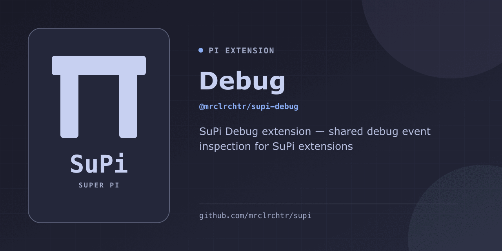
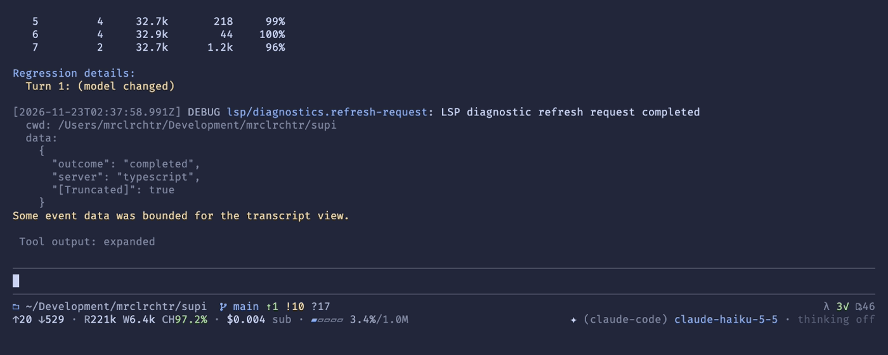
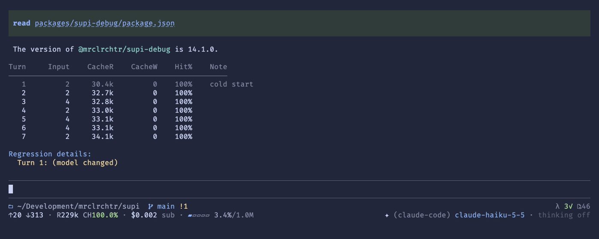
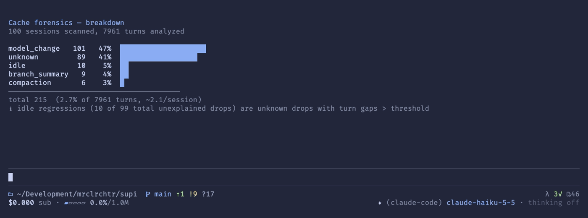

<div align="center">
  <a href="https://github.com/mrclrchtr/supi/tree/main/packages/supi-debug">
    
  </a>
</div>

# @mrclrchtr/supi-debug

[](https://github.com/mrclrchtr/supi/stargazers) [](https://www.npmjs.com/package/@mrclrchtr/supi-debug)

Adds shared debug-event capture and inspection for SuPi extensions in the [Pi coding agent](https://github.com/earendil-works/pi).

## Install

```bash
pi install npm:@mrclrchtr/supi-debug
```

For local development:

```bash
pi install ./packages/supi-debug
```



## What you get

After install, this package wires the shared debug registry into three user-facing surfaces:

- `/supi-debug` — show recent debug events in a readable TUI report
- `debug` — let the model query recent debug events during troubleshooting
- `tui_render` (opt-in) — let the model see how any tool result renders in the TUI (see [below](#see-how-tool-results-render-tui_render))
- `/supi-settings` integration — configure whether events are captured and how much data is exposed
- `/supi-cache-history`, `/supi-cache-forensics`, and `cache_forensics` — prompt-cache history and cross-session regression forensics (see [below](#prompt-cache-history-and-forensics))

It also registers a **Debug** provider section for `/supi-context`, provides a `/supi-tooling-retro` command for feedback on the task just completed (see [below](#tooling-retrospectives)), and discovers two skills over past sessions: **`gather-retrospectives`** collects feedback, and **`session-analytics`** (command only) measures tool usage, failures, and debug-log volume.

### Gather past retrospectives

Ask naturally, for example “gather retrospective feedback about `packages/supi-agent`,” or invoke:

```text
/skill:gather-retrospectives collect feedback from delegated runs in this workspace
```

The skill uses a bundled Node.js collector to read stored Agent Run assessments and `/supi-tooling-retro` reports. It defaults to the current workspace directory tree and all dates, preserves source references, deduplicates cloned runs, and saves paginated evidence in temporary files. Other projects and sibling worktrees require explicit scope. Source filters identify who produced an assessment, not which package it concerns. The collector displays complete assessments within a 16 KB stdout budget; `omittedRefs` identifies assessments that need a targeted read from the full evidence file.

`/supi-tooling-retro` reports written before the command stored them are not collected. The collector does not enable capture, execute new assessments, or verify historical claims. Stored prose may still contain sensitive task details. Run the bundled `skills/gather-retrospectives/scripts/collect.mjs` with `--help` for storage overrides and filters. Node and shell access are required; no extra runtime dependencies are needed.

### Measure past tool usage

The skill runs only on explicit request; the model does not select it on its own. Invoke it with a question, for example:

```text
/skill:session-analytics how often did agents call code_find in the last 30 days, and in how many sessions was it available?
```

The skill runs a bundled Node.js exporter that streams session storage once and writes one JSONL file of tool calls (truncated arguments, result status, size and head, and the next calls), per-session tool availability, or debug-event sizes. The agent then aggregates that file in a script. It uses the same storage discovery and workspace scope as `gather-retrospectives`, never modifies sessions, and reads files linearly, so abandoned branches count too. Run `skills/session-analytics/scripts/export.mjs --help` for all options.

## Event behavior

- events are session-local
- sanitized events at or above `persistLevel` (default `info`) are also persisted in the session JSONL for later inspection; lower-level events, such as per-file Tree-sitter and per-request LSP timings, stay in the live retained buffer only
- the event buffer is cleared on `session_start`
- if debug capture is disabled, no events are retained
- agent-facing access is blocked, sanitized, or raw depending on settings
- each `session_start` (startup, reload, new, resume, fork) records one `runtime-provenance` event: the package `version`, the `reason`, and — only when SuPi loads from its own workspace checkout — `commit`, `commitTime`, and `dirty` (tracked files changed). Evidence collectors use it to filter sessions by code state

### Identity disclosure

Retained and persisted LSP debug events may identify local workspaces and files. Since the LSP telemetry expansion, LSP events can carry the absolute workspace root (`cwd`), the configured server name (`server`), workspace-relative file paths (`file`), exact LSP method names (`method`), and the server root (`root`). Identity strings are bounded to 512 UTF-16 code units and server lists to 16 entries.

Identity fields are **not** secret-redacted. The debug registry redacts secret keys and secret-looking values (tokens, passwords, API keys, authorization headers, URL credentials), but server names, file paths, method names, and workspace roots pass through unredacted by design, so local protocol failures stay diagnosable. Treat retained and persisted LSP events as potentially identifying your local machine, project layout, and file names.

## Rendering

`/supi-debug` uses a custom TUI message renderer that shows two levels of detail:

- **Collapsed** (default) — a one-line summary:

  ```
  3 events — lsp/rewrite +2 more
  ```

- **Expanded** — full details with timestamp, level, source/category, message, cwd,
  and data for each event. **Click/expand the collapsed message** in the TUI to reveal
  the full output.

Rendered fields per event:

- timestamp
- level
- `source/category`
- message
- optional `cwd`
- optional `data`
- optional `rawData`
- optional `operationId` for events directly owned by one public `code_*` call

### Why collapsed by default

Event payloads can be large (full command strings, structured data). Collapsing
keeps the conversation focused; expand only when you need the details.

### Seeing full details without expanding

The agent-facing `debug` tool returns the expanded plain-text
representation, subject to PI's standard tool-output truncation limits. This is
useful for automated troubleshooting flows while protecting the model context
from very large event payloads.

## Structured results

`debug` declares PI's native `outputSchema`. Direct calls retain readable, bounded
text; default codemode calls resolve to structured data without parsing that text:

```js
const result = await tools.debug({ source: "lsp", limit: 20 });
return {
  messages: result.events.map((event) => event.message),
  complete: result.selection.complete,
  omitted: result.selection.omittedEventCount,
};
```

| Field | Contract |
| --- | --- |
| `events` | All query-selected events, newest first: `id`, millisecond `timestamp`, `source`, `level`, `category`, `message`, and optional `operationId`, `cwd`, `data`, `rawData`. Producer-defined diagnostic fields remain data, not rendered Markdown. |
| `provenance` | Live: `{ kind: "live", scope: "retained-buffer" }`. Historical: `{ kind: "persisted", sessionFile, persistedEventCount, invalidEventCount, malformedLineCount }`, with the resolved file path. Event counts cover recognized persisted debug entries. `malformedLineCount` counts every nonblank line that cannot be parsed, independently of event filters; malformed contents are never returned. Blank lines and valid unrelated entries are ignored. |
| `selection` | Exact `matchedEventCount` before the query limit, `returnedEventCount`, `omittedEventCount`, and `complete`. Complete means all matches in this source were returned, no recognized persisted debug payloads were invalid, and no nonblank JSONL lines were malformed. Live evidence covers only the retained buffer, not the entire session. |
| `rawAccessDenied`, `rawDataUnavailable` | Disclose denied live raw requests or requested historical raw data, which is never available. Sanitized `data` retains the existing best-effort secret redaction; identity fields remain identifying. |
| `dataNormalized` | Non-JSON diagnostic values were replaced with text markers. Ordinary JSON values are preserved without the UI's data-size bounds. |
| `emptyReason` | Present for empty selections: `no-persisted-events`, `no-matches`, or `query-limit` (a positive fractional limit can round down to zero). `no-persisted-events` requires a parseable session with no recognized debug entries; a malformed-only file reports `no-matches` with incomplete evidence instead. An empty selection is not a failure; check `selection.complete` for incomplete evidence. |
| `modelOutput` | `truncated`, plus `outputLines`, `totalLines`, `outputBytes`, and `totalBytes` when text was truncated. These bounds do not truncate structured events. |

Structured event data is a detached JSON snapshot. Bigints become strings such as
`"2n"`; non-finite numbers become their text names. Unsupported values use
`[Undefined]`, `[Function]`, `[Symbol]`, `[Non-JSON object]`, `[Circular]`, or
`[MaxDepth]` (nesting at 64 containers). Runtime instances and hidden state are not
exposed. Repeated non-cyclic JSON objects are preserved independently.

Filters and `limit` control structured selection; there is no separate format or
execution mode and no pagination. Use a smaller limit or narrower filters when
processing large historical sessions. Tool UI details remain separately bounded
to 12 raw-free events; query-limit omissions, invalid event payloads, and malformed
JSONL lines are disclosed in the transcript. Requested raw-access warnings are
retained even for empty selections. Opted-in live raw data can appear in both result text
and structured data, even though it is excluded from UI details and sanitized
debug-event persistence.

Invalid input, disabled access/capture, file-read failures, and scan cancellation
still throw; they are not converted to successful empty results. Codemode callers
can catch these rejections normally. This tool has no returned-failure variant.

## Filters

Both `/supi-debug` and `debug` support the same basic filters:

- `source`
- `level`
- `category`
- exact `operationId`
- `limit`

For historical sessions, pass `sessionFile` to `debug`, or
`sessionFile=<path>` to `/supi-debug`. Historical sessions never retain raw data.
The tool also accepts `includeRaw` for live-session data when settings allow it. A Debug Operation ID groups direct request ownership only. It is not a security identity, distributed trace, raw Pi Tool-call identity, or time-window correlation.

## Settings

This package registers a **Debug** section in `/supi-settings`.

Available settings:

- `enabled` — turn session-local event capture on or off
- `agentAccess` — `off`, `sanitized`, or `raw`
- `maxEvents` — maximum retained events in memory. When the buffer is full, the oldest `debug` event is dropped first, so per-request timings do not push out `info`, `warning`, and `error` events; those keep at most half of the buffer. Within each part, the oldest event of the most frequent source and category goes first, so one flooding category such as `request.timing` keeps only its newest events instead of pushing out rarer `debug` events such as `workspace-symbol.warm-probe`
- `persistLevel` — minimum level (`debug`, `info`, `warning`, `error`) written to the session file; default `info`. Set `debug` to persist high-volume timing telemetry, which can add hundreds of MB across sessions. Live `/supi-debug` and `debug` queries still see all retained levels
- `tuiRenderTool` — activate the `tui_render` tool; off by default, so it adds no prompt cost until enabled
- `agentRunRetrospectivesEnabled` — opt in to Agent Run retrospectives; off by default and eligible only while Debug capture and its session persistence sink are active and `persistLevel` admits `info` events. Retrospective prose is stored in the sanitized event data using the existing Debug session-entry path.

With retrospective collection enabled, completed Delegation and Reviewer Runs publish their task results before performing one tool-free assessment. Find the reports using category `agent-run-retrospective` and source `supi-agent` or `supi-review`. Reports include their own Usage, separate from task Usage, plus `runKey`, `batchId`, `taskId`, and a readable `label`. Delegation reports also include `conversationId` to match saved conversations and follow-ups. Collection is best effort and stops on cancellation or session shutdown. Assessment prose can still contain sensitive task details despite best-effort secret redaction; it is self-reported feedback, not verified savings.

### Tooling Retrospectives

After a task, run `/supi-tooling-retro`. It asks the agent for a compact retrospective of the SuPi surfaces used in the preceding task: what helped, what fell short, what was missing, and what was noisy, including slow navigation, unreachable information, and instructions that changed nothing. Each proposal names its mechanism and prefers a deterministic check or a tool change over new guidance text. If the agent is still working, the command waits until it is idle.

Before it starts, the command asks where the retrospective runs. **Side branch** is preselected; it is also used without dialog support, such as in print mode. **Main path** runs it as a normal turn: the prompt and report stay in the agent's context, so you can discuss the report or act on it directly. Dismissing the dialog cancels the command.

On the side branch, the retrospective runs on a branch of the session tree. When it ends, successful or not, the command returns to the point where it started and shows the report there as a display-only entry. The next prompt therefore continues the task without the retrospective prompt or answer in the agent's context. The command finishes only after the report, and steering messages sent during it stay on the side branch. To discuss the report with the agent, open the side branch with `/tree`. The branch point is a hidden bookkeeping entry, so the default `/tree` filter shows the retrospective as a straight continuation of the task, without a `├─` fork; only the missing `•` active-path marker sets it apart. Switch to the `all` filter (`ctrl+a`) to see the fork.

When Debug capture is enabled, its session persistence sink is active, and `persistLevel` admits `info` events, a normally completed report is stored as a Debug event with category `tooling-retrospective` and source `supi-debug`, so `gather-retrospectives` can collect it (`--source supi-debug`). The event data holds `text`, `status`, `promptRevision`, and a `runKey` for deduplication across forks. Aborted, failed, or truncated answers are not stored, and the command says so. Without active persistence, the command still runs and states that the report is not stored. No separate setting exists.

Historical inspection works for events captured after this extension is loaded. For example, an
agent can call `debug` with `sessionFile` set to a PI session JSONL path.

Defaults come from the shared debug registry:

```json
{
  "debug": {
    "enabled": false,
    "agentAccess": "sanitized",
    "maxEvents": 100,
    "agentRunRetrospectivesEnabled": false,
    "tuiRenderTool": false
  }
}
```

## See how tool results render (`tui_render`)

`tui_render` lets an agent check its own TUI changes instead of asking for screenshots. It renders one stored tool result from the current session branch through the same renderers, theme, and frame the transcript uses. It works for any tool: built-in, SuPi, other extensions, and MCP. It never runs the rendered tool.

Enable **TUI Render Tool** in the **Debug** section of `/supi-settings` (`tuiRenderTool`). Then, for example:

```json
{ "target": { "tool": { "name": "code_health" } }, "expanded": true, "format": "marked" }
```

- `target` — exactly one of `tool: { name, index? }` (`index` 0 is the latest result of that tool) or `toolCallId`
- `expanded` — render the expanded view; default collapsed
- `width` — terminal columns (20–400); default the current terminal width, clamped to that range
- `format` — `plain` (visible text, default), `ansi` (raw terminal colors), or `marked` (theme tokens such as `[success]3[/success]`, in the `createMarkedTheme()` format of `@mrclrchtr/supi-test-utils`)

`marked` wraps lines exactly where the TUI does. It marks styling that goes through the renderer's theme argument. Text Pi styles with its global theme, such as Markdown, the frame background, and Pi's generic fallback, stays unmarked; the result notes this. The result also reports whether each slot used the tool's own renderer or Pi's fallback, and any renderer exception that made Pi fall back.

Renderers come from Pi's own resolution (`pi.registerToolRenderer`), recorded when the TUI draws a tool. After a renderer change, run `/reload`: the next render uses the reloaded code. A tool the TUI has not drawn since this extension loaded, and resolvers of extensions loaded before SuPi Debug, are not seen. `tui_render` needs the interactive TUI and fails in print, JSON, and RPC modes.

Calls a tool made inside another tool, such as `tools.read()` in a `codemode` script, have no stored result of their own. Pi draws them inside the parent row, so `tui_render` names the parent `toolCallId` to render instead.

The model text omits the row's blank edge lines; `structuredContent.lines` keeps the exact row. In the transcript, a collapsed `tui_render` shows a summary and the first lines the result renderer drew (the call header is already in the summary); expand it for the full text.

## Prompt-cache history and forensics

Formerly the standalone `@mrclrchtr/supi-cache` package. PI owns live cache statistics and cache-miss notices (enable transcript notices with `showCacheMissNotices`); this package adds two views:

1. **Current-branch history**
   - reads usage from native PI assistant messages
   - shows input, cache reads, cache writes, and hit rate for each request
   - keeps old prompt-change notes and fingerprints when they exist

2. **Historical forensics**
   - scans active branches across past sessions
   - finds cache hotspots and idle-time drops
   - groups model changes, compactions, branch summaries, prompt changes, and unknown causes
   - correlates drops with redacted tool-call shapes



### Cache Commands and tool

#### `/supi-cache-history`

Shows per-turn cache usage for the current branch.

The report includes:

- input tokens
- cache-read tokens
- cache-write tokens
- cache hit rate
- known cause notes from current or old session records

#### `/supi-cache-forensics`

Runs a cross-session investigation.

Supported patterns:

- `breakdown` — count findings by cause
- `hotspots` — show the largest hit-rate drops
- `correlate` — show preceding redacted tool shapes, ranked by hit-rate drop
- `idle` — show drops after long gaps between requests

Useful flags:

- `--since 7d`
- `--pattern breakdown`
- `--min-drop 20`
- `--limit 50` (maximum findings returned; list patterns default to 50)



#### `cache_forensics`

Adds one model-callable tool with the same four patterns. The result uses structural tool fingerprints and removes raw command and path details before it reaches the model.

List patterns return at most 50 findings by default. Use the tool's `limit` parameter, or the command's `--limit` flag, to request up to 200 findings. Hotspots exclude structural events with no measurable drop. The result is also bounded to 2,000 lines or 51,200 bytes. Large results are written to a private temporary file and return a summary envelope.

Codemode receives native data matching the registered output schema; direct calls receive JSON for the same object. Both return either the complete result or a spill summary with `truncated: true` and `fullOutputPath`, never partial findings. The spill file contains the complete normalized, redacted, query-limited result. `findingsTotal` and `findingsLimit` appear only when the query limit removes findings. `sessionsScanned` counts sessions with extracted turns; unreadable sessions and sessions without turns are skipped.

```js
const result = await tools.cache_forensics({ pattern: "hotspots", limit: 5 });
return "truncated" in result
  ? { fullOutputPath: result.fullOutputPath }
  : { sessions: result.sessionsScanned, drops: result.findings.map((finding) => finding.drop) };
```

### Cache Configuration

Forensics reads these optional values from the `cache` section. They are also available in `/supi-settings` under **Cache Forensics**:

```json
{
  "cache": {
    "regressionThreshold": 25,
    "idleThresholdMinutes": 5
  }
}
```

The loader also reads these two values from the old `cache-monitor` section. Old `enabled` and `notifications` values are ignored. Configure live PI cache notices with PI's `showCacheMissNotices` setting.

### Cache Native session data

Native assistant-message usage is the source of truth. SuPi Debug also reads old `supi-cache-turn` custom entries so old sessions keep their prompt-change details. New sessions do not create custom cache records.

## Extra status logging

If `SUPI_LOG_STATUS` is enabled in the environment, the package emits a versioned SuPi load-status marker to stderr during `resources_discover` (after session-start registrations) and appends the same payload as a session entry. The payload uses `phase: "resources_discover"`. Version 2 reports observed tool and command inventory only; external harnesses decide which resources they require.

## Source

- `src/debug.ts` — settings, command, tool, and registry wiring
- `src/renderer.ts` — custom report renderer
- `src/format.ts` — debug payload formatting
- `src/status-log.ts` — optional load-status logging
- `src/cache/` — cache history, forensics pipeline, reports, and settings
- `src/tool/cache_forensics/` — cache forensics agent tool
