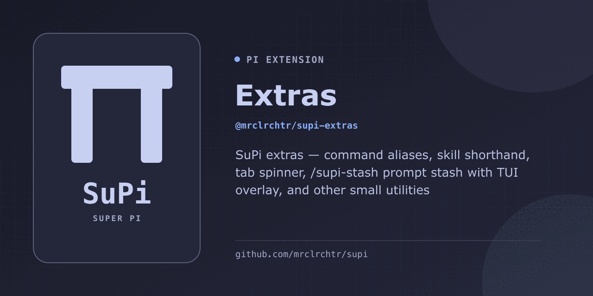
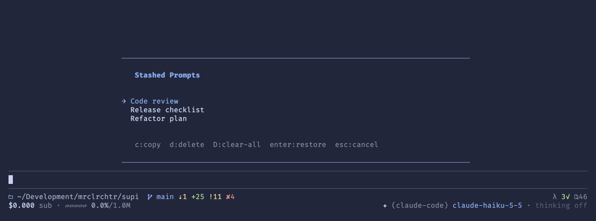

<div align="center">
  <a href="https://github.com/mrclrchtr/supi/tree/main/packages/supi-extras">
    
  </a>
</div>

# @mrclrchtr/supi-extras

[](https://github.com/mrclrchtr/supi/stargazers) [](https://www.npmjs.com/package/@mrclrchtr/supi-extras)

Adds a bundle of small quality-of-life features to the [pi coding agent](https://github.com/earendil-works/pi).

## Install

```bash
pi install npm:@mrclrchtr/supi-extras
```



## Commands

- `/exit` — exit pi
- `/e` — alias for `/exit`
- `/clear` — start a new session (alias for `/new`)
- `/clone-session <session-id>` — clone a session into the current worktree and switch to it; autocomplete searches IDs and session names
- `/supi-stash` — browse, restore, copy, delete, or clear saved prompt drafts
- `/supi-capabilities` — choose extension tools and model-visible skills for this session

## Session capabilities

`/supi-capabilities` opens a searchable selector. Use it to change extension tool and skill visibility for the current session.

- The selector lists only extension tools that were active at startup. It does not list PI built-in tools or tools supplied by integrations.
- Tool and skill overrides are stored in the session. Resume restores them. Fork and `/clone-session` copy them. New sessions use the optional default profile; without a default, they start without overrides.
- Tree navigation keeps explicit capability tool choices and does not change other tool choices.
- The selector waits until the agent is idle before it opens. It does not interrupt a running tool call.
- Saved tool and skill exclusions remain stored when an item is absent. They apply if the item becomes eligible later.
- Skill changes affect the model skill catalog only. Explicit `/skill:name` commands and `$name` shortcuts stay available.
- Use **Reset Tools**, **Reset Skills**, or **Reset All** to remove overrides.
- The footer shows an override count and the applied profile name. `Modified` means session exclusions differ from the copy captured when the profile was applied.

Install [`@mrclrchtr/supi-skills`](https://github.com/mrclrchtr/supi/tree/main/packages/supi-skills) to manage skills. Tool controls work without that package.

### Session Capability Profiles

Use Tab to open **Profiles** in `/supi-capabilities`. Apply a saved profile, save current exclusions under a new name, replace or delete a saved profile, or choose a default. Saving requires an explicit global or project scope. Replacement and deletion require confirmation.

Profiles contain **exclusions**, not a fixed list of available capabilities. New eligible tools and skills remain available unless their exact names are excluded. Package rows select current tools only; they do not create rules for future tools. Profiles do not change the model, instructions, child Agent Profiles, or security permissions.

Store definitions in `~/.pi/agent/supi/config.json` or a trusted project's `.pi/supi/config.json`:

```json
{
  "sessionCapabilities": {
    "profiles": {
      "research": {
        "excludedTools": ["agent_run"],
        "hiddenSkills": ["implement"]
      }
    },
    "defaultProfile": "research"
  }
}
```

- Profile IDs contain lowercase words separated by optional hyphens. Omitted exclusion lists are empty. Unknown fields and invalid values produce errors.
- Project profiles and defaults require Pi project trust. A project definition replaces the complete global definition with the same ID. An invalid project definition blocks that ID; it does not use the global definition instead.
- An absent project `defaultProfile` inherits the global default. Set it to `null` to use no default in that project. Missing or invalid defaults produce a warning and normal startup without profile exclusions.
- Applying a profile replaces both session selections and stores a separate session copy. Later configuration edits, deletion, and reload do not change that copy. Resume and fork do not apply a new default.
- Saving a profile does not apply it. Apply it explicitly to use its current saved definition.
- Deletion leaves default references unchanged. Deleting a project definition can expose a same-ID global definition; the confirmation explains this effect.
- **Reset All** clears session exclusions and profile identity. It does not change saved profiles or defaults, and it does not reapply the default in the current session.
- Manual profile management is TUI-only. Configured startup defaults also work in non-interactive modes.

## Shortcuts

- `Alt+S` — stash the current editor text
- `Alt+C` — copy the current editor text to the system clipboard

## Prompt stash

Prompt stash stores drafts in `~/.pi/agent/supi/prompt-stash.json` so they survive restarts.

`/supi-stash` opens an overlay with these actions:

- `Enter` — restore the selected draft into the editor
- `c` — copy the selected draft to the clipboard
- `d` — delete the selected draft
- `D` — clear all drafts
- `Esc` — close the overlay

If the stash file cannot be read or written, drafts are kept in memory only and can be lost when pi closes.

## Passive behavior

### Tab-title spinner

While the agent is working, the package animates a spinner in the terminal tab title. When the turn finishes, it shows a done marker. The spinner pauses while a question waits for your answer.

### Footer replacement

The package replaces pi's default footer. It shows the model and thinking level with theme colors.

### Headless git safety

The package sets:

- `GIT_EDITOR=true`
- `GIT_SEQUENCE_EDITOR=true`

That prevents git subprocesses from hanging while waiting for an interactive editor.

### Default bash timeout

PI's `bash` tool has no default timeout. When the model calls `bash` without `timeout`, the package fills in a default (120 seconds) so a hung command cannot stall an unattended session. Explicit `timeout` values are kept; other tools are untouched.

Configure it in `/supi-settings` → **Bash Timeout** → **Default Timeout** (seconds), stored in the `bash-timeout` section of `~/.pi/agent/supi/config.json` or `.pi/supi/config.json`. This replaces the former `@mrclrchtr/supi-bash-timeout` package; existing settings keep working.
