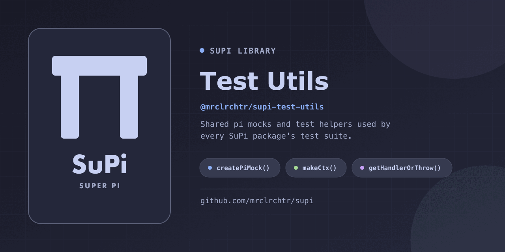

<div align="center">
  <a href="https://github.com/mrclrchtr/supi/tree/main/packages/supi-test-utils">
    
  </a>
</div>

# @mrclrchtr/supi-test-utils

[](https://github.com/mrclrchtr/supi/stargazers)

Shared test helpers for SuPi extension packages.

This is a **workspace-internal** package (`"private": true`). It is meant for tests inside this repo, not for `pi install`.

## What it exports

- `createPiMock()` — mock `ExtensionAPI` with captured handlers, commands, tools, renderers, shortcuts, messages, entries, event-bus handlers, and exec calls
- `makeCtx()` — minimal mock handler context with easy overrides
- `getHandler()` / `getHandlerOrThrow()` — fetch registered `pi.on(...)` handlers from the mock
- `getTools()` / `getTool()` — inspect registered tools with typed helpers
- `createMarkedTheme()` — test theme that marks colors and styles in rendered text, so TUI render tests can assert tone
- `ToolDef` — simple tool type used by the tool helpers
- `@mrclrchtr/supi-test-utils/background` — background harness for extensions that start Agent Runs in child SDK sessions (see below)

## `createPiMock()`

Use this when testing extension wiring.

```ts
import { createPiMock } from "@mrclrchtr/supi-test-utils";

const pi = createPiMock();
myExtension(pi as unknown as ExtensionAPI);

expect(pi.handlers.has("session_start")).toBe(true);
expect(pi.tools.length).toBe(1);
```

Useful captured state on the returned mock includes:

- `handlers`
- `commands`
- `tools`
- `renderers`
- `entries`
- `messages`
- `shortcuts`
- `execCalls`

It also provides helper methods such as:

- `emit(event, ...)`
- `getHandlers(event)`
- `getCommandHandler(name)`
- `getShortcutHandlers(key)`
- `getExecCalls()`

## `makeCtx(overrides?)`

Use this when testing handlers directly.

```ts
import { makeCtx } from "@mrclrchtr/supi-test-utils";

const ctx = makeCtx({ cwd: "/other" });
await handler("args", ctx);
```

The default mock context includes:

- `cwd`
- `model`
- a mocked `ui` object
- a mocked `sessionManager.getBranch()`
- `getContextUsage()`
- `getSystemPrompt()`

## Handler and tool helpers

Use these helpers to avoid direct non-null assertions in tests:

```ts
const handler = getHandlerOrThrow(pi, "message_end");
await handler(event, ctx);

const tool = getTool(pi, "web_docs_search");
await tool.execute("tc-1", { libraryName: "react" }, undefined, undefined, ctx);
```

## `createMarkedTheme()`

Use this when a render test must check tone, not just text. A plain test theme (`fg: (_color, text) => text`) discards the color, so it cannot catch a zero count rendered in success color.

```ts
import { createMarkedTheme } from "@mrclrchtr/supi-test-utils";

const theme = createMarkedTheme();
theme.fg("success", theme.bold("0")); // "[success][bold]0[/bold][/success]"

const output = renderResult(result, options, theme as never, undefined).render(200).join("\n");
expect(output).toContain("[muted]none checked");
expect(output).not.toContain("[success]");
```

Keep the plain theme for tests that only assert text. Adopt the marked theme where tone carries meaning, such as diagnostics, status, or errors. Tokens add width, so render at a generous width.

## Background harness

`@mrclrchtr/supi-test-utils/background` tests an extension that starts child SDK sessions at the seam the parent observes: registered tool handlers, controlled child sessions, parent turn boundaries, and a real parent `SessionManager` that stores tool results. It is a separate subpath so tests that do not need the Pi SDK do not load it.

The harness has no owner policy. The test passes the extension under test and calls its tools by name:

```ts
import { backgroundHarness } from "@mrclrchtr/supi-test-utils/background";

const sdk = vi.hoisted(() => ({ createAgentSession: vi.fn(), createAgentSessionRuntime: vi.fn() }));
vi.mock("@earendil-works/pi-coding-agent", async (importOriginal) => ({
  ...(await importOriginal<typeof import("@earendil-works/pi-coding-agent")>()),
  ...sdk,
}));

const harness = await backgroundHarness({ sdk, extension: ownerExtension });
const started = await harness.invoke("owner_run", { prompt: "Inspect one" });
harness.child("Inspect one").finish("Done");
await harness.close();
```

- `invoke(name, params, options?)` stores the assistant tool call and the tool result, and ends the parent turn once no invocation is in flight. Pass `{ persist: false }`, `{ endTurn: false }`, or a `resultHook` to model other Pi paths.
- `beginParent()` / `endParent(aborted?)` / `deliverQueued()` model a running parent turn, its settlement, and delivery of queued custom messages through the extension's `context` handler.
- `replaceSession()`, `reopenParent()`, and `openParent(manager)` shut down and restart the parent session.
- `children` and `child(key)` expose controlled sessions; `finish()`, `fail()`, `failProvider()`, and `holdDisposal()` drive a child. `holdNextStartup()` pauses the next child creation.
- Options: `childPrompt` maps a `child(key)` lookup to prompt text, `prepare` writes files into the temporary agent directory before the extension loads, `baseContext` replaces the default test model context, `childUsage` replaces `controlledUsage`, and `persistentParent` stores the parent session on disk.

The harness does not depend on any SuPi package. Read shared state such as the Agent Run Registry in the owner's test helper from `harness.pi`.

## Mocking guidance

When mocking `@mrclrchtr/supi-core`, prefer `importOriginal` so new runtime exports do not break older tests:

```ts
vi.mock("@mrclrchtr/supi-core", async (importOriginal) => {
  const actual = await importOriginal<typeof import("@mrclrchtr/supi-core")>();
  return {
    ...actual,
    loadSupiConfig: vi.fn(),
    defineConfigSettings: vi.fn((options) => options),
    registerSettings: vi.fn(),
  };
});
```

## Package layout

This package follows the **stay flat utility package** convention from `docs/conventions/package-layout.md`:

```text
src/
  api.ts           # Public API surface
  index.ts         # Package-root re-export surface
  pi-mock.ts       # createPiMock(), makeCtx()
  marked-theme.ts  # createMarkedTheme()
  handler-utils.ts # getHandler(), getHandlerOrThrow()
  tool-utils.ts    # getTools(), getTool(), ToolDef
  background-harness.ts # backgroundHarness() (subpath ./background)
  background-session.ts # controlledSession()
__tests__/
  helpers/         # Shared test utilities
  fixtures/        # Test data
  unit/            # Focused fast tests
  integration/     # Integration tests
```

## Source

- `src/api.ts` — public API surface, re-exports all public functions
- `src/index.ts` — package-root re-export surface, re-exports from `api.ts`
- `src/pi-mock.ts` — `createPiMock()` and `makeCtx()`
- `src/marked-theme.ts` — `createMarkedTheme()`
- `src/handler-utils.ts` — handler lookup helpers
- `src/tool-utils.ts` — tool lookup helpers
- `src/background-harness.ts` — background harness, exported as `./background`
- `src/background-session.ts` — controlled Pi SDK child session
