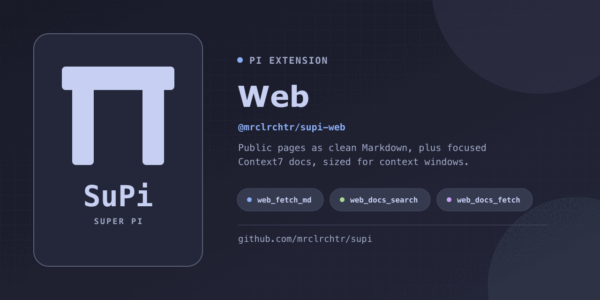

<div align="center">
  <a href="https://github.com/mrclrchtr/supi/tree/main/packages/supi-web">
    
  </a>
</div>

# @mrclrchtr/supi-web — Web Fetch, Search, and Context7 for Pi

[](https://github.com/mrclrchtr/supi/stargazers) [](https://www.npmjs.com/package/@mrclrchtr/supi-web)

Adds web fetch, public web search, and Context7 documentation tools to the [Pi coding agent](https://github.com/earendil-works/pi), without making you paste sources into chat.

## What your agent gets

After installation, keep asking Pi normal questions. The agent can:

- **Read public web pages as best-effort Markdown** — prefer main content, but results may include page clutter or omit content.
- **Prefer source Markdown when available** — detect Markdown responses and common Markdown siblings before converting HTML.
- **Handle plain-text and source files** — wrap them in fenced code blocks with a language hint when the URL provides one.
- **Look up current library docs** — search Context7 for the right project and version, then retrieve documentation focused on the task at hand.
- **Search public web sources** — return source titles, URLs, and source excerpts without generating an answer.
- **Protect the context window** — return small results inline, move long pages to temporary files, and preserve full output when model-visible text must be truncated.

When converting HTML, relative links and image sources become absolute by default. Native Markdown is returned unchanged.

## Example requests

You do not need to learn the tool-call syntax. Try asking Pi:

- “Read this public design document and summarize the decisions: `https://example.com/spec`.”
- “Check the current React documentation for effect cleanup.”
- “Find the FastAPI docs for lifespan events and show the recommended pattern.”
- “Fetch this long reference page to a file, then read only the relevant section.”
- “Compare this library's current docs with the code in the repository.”

## Agent tools

The package adds four tools that Pi selects as needed:

| Tool | What it lets the agent do |
|---|---|
| `web_fetch_md` | Fetch a public HTTP(S) page and return readable Markdown, fenced plain text, or a temporary file |
| `web_search` | Search the public web and return source titles, URLs, and source excerpts |
| `web_docs_search` | Find matching Context7 library IDs, versions, trust scores, benchmark scores, and snippet counts |
| `web_docs_fetch` | Retrieve focused documentation for a chosen Context7 library ID |

Pi searches Context7 first when the library ID is unknown, then fetches docs with the selected ID. Narrow questions produce more useful documentation context than broad requests. Documentation returns as Markdown by default; the agent can request structured JSON snippets when needed.

### Structured results in codemode

All four tools declare PI-native `outputSchema` contracts. Direct calls still return readable, bounded text; `await tools.<name>(args)` in codemode resolves to structured data, not that text or UI `details`.

| Tool | Structured value |
|---|---|
| `web_fetch_md` | `mode: "inline"` with the full returned `markdown`, or `mode: "file"` with `filePath`; both include source `url`, `chars`, and `lines` |
| `web_search` | Complete `sources` (`title`, `url`, `excerpts`, optional `sourceDate`), `sourceCount`, and `excerptCount` |
| `web_docs_search` | All `results` with IDs, names, complete descriptions/versions, scores, and snippet counts; `count` is the number returned by Context7 |
| `web_docs_fetch` | `libraryId`, `chars`, `lines`, and either `format: "markdown"` with complete `markdown`, or `format: "snippets"` with SDK-normalized `snippets` (`title`, `content`, `source`) for `raw: true` |

Inline/data results include `modelOutput.truncated` and, when text is truncated, `modelOutput.fullOutputPath`. These describe the **direct-call text**, not missing structured data. Library search also reports `modelOutput.omittedResults`: matches excluded by the table's top-10 row limit before line/byte truncation. Structured descriptions and version lists are not shortened. File-mode page fetches retain the existing disk delivery instead of duplicating the body in structured data.

Results describe the evidence returned by the provider, not exhaustive coverage of a page, the web, or a library. Empty search arrays and empty snippet arrays are successful outcomes. Authentication, network, malformed web-search data, and cancellation failures still throw; codemode calls reject rather than returning a successful empty result. No tool currently returns a schema-defined failure or paginated result.

```javascript
const libraries = await tools.web_docs_search({
  libraryName: "react",
  query: "effect cleanup",
});
if (libraries.results.length > 0) {
  const docs = await tools.web_docs_fetch({
    libraryId: libraries.results[0].id,
    query: "effect cleanup",
    raw: true,
  });
  return docs.snippets.map(({ title, source }) => ({ title, source }));
}
return [];
```

Structured values can be larger than their text previews. Select the fields you need before printing them. The package's `./api` export provides `WebFetchMdOutput`, `WebSearchOutput`, `WebDocsSearchOutput`, and `WebDocsFetchOutput` types. Active Pi sessions need `/reload` or a restart to load extension changes.

HTTP fetch failures include the requested URL and response status in the error message. For independent batch fetches, catch each call so a missing page does not stop the remaining work:

```javascript
for (const url of urls) {
  try {
    const page = await tools.web_fetch_md({ url, outputMode: "file" });
    text({ url, filePath: page.filePath });
  } catch (error) {
    text({ url, error: String(error) });
  }
}
```

Uncaught failures stop the codemode script; `store()` writes are committed only when the script succeeds. The fetch tool does not discover relocated pages automatically.

## Web Search

`web_search` uses the installed `bx` executable. The tool is enabled by default, but it is available only when `bx` is on `PATH`. Search freshness accepts `pd`, `pw`, `pm`, `py`, or an ordered `YYYY-MM-DDtoYYYY-MM-DD` range.

### Set up bx

Install `bx` and configure it with the [Brave Search CLI instructions](https://github.com/brave/brave-search-cli). Start Pi from the shell where `command -v bx` finds the executable, then verify it with `bx --version`. `bx` handles its own credentials and configuration. Do not put credentials in Pi settings, prompts, or repository files.

To enable or disable the tool, open `/supi-settings`, choose **Web**, and change **Web Search tool**. Run `/reload` after the change. The setting applies only when the extension starts or reloads. If `bx` was not available, install or configure it, make sure it is on `PATH`, and run `/reload`.

Search results are provider-reported source material. A source date can be a publication or modification date and is not a publication-date guarantee.

## How page fetching works

`web_fetch_md` tries these representations in order:

1. Use Markdown returned directly by the server.
2. Detect Markdown or plain text from the response content.
3. Check common `.md`, `.markdown`, `index.md`, and `README.md` alternatives.
4. For HTML, extract the primary readable content and convert it to GitHub-flavored Markdown.

It follows redirects and, for HTML, removes scripts and styles while preserving headings, links, lists, code blocks, and tables.

Native Markdown is returned unchanged, including relative links and code examples. For HTML conversion, `absLinks` defaults to `true`; set it to `false` to preserve original link and image destinations. Unsafe URL schemes are removed in either HTML mode.

### Optional Firecrawl retrieval

Direct fetching remains the default and needs no API key. To allow Firecrawl, open `/supi-settings`, choose **Web**, and enable **Firecrawl** in project or global scope. It is off by default. Changes apply to subsequent fetch calls without `/reload`; enabling it permits agent-selected retrieval, not automatic URL sharing or fallback.

Export `FIRECRAWL_API_KEY` before starting Pi. The key stays in the environment, not settings. Enabling without a key saves the preference and shows a warning; direct fetching remains available.

The agent can select one `fetchMode`:

| Mode | Behavior |
|---|---|
| `direct` (default) | Use the local negotiation and conversion pipeline; never contact Firecrawl |
| `firecrawl_fallback` | Fetch directly, then use Firecrawl only after terminal HTTP 403 |
| `firecrawl` | Skip direct fetching and use Firecrawl immediately, useful for JS-rendered pages or poor local extraction even after HTTP 200 |

Both Firecrawl modes require the setting to be enabled. While disabled, explicit Firecrawl calls fail before DNS or HTTP requests.

For a public page blocked with HTTP 403:

```javascript
const page = await tools.web_fetch_md({
  url: "https://example.com/article",
  fetchMode: "firecrawl_fallback",
  outputMode: "file",
});
return page;
```

For JS-rendered content, select `fetchMode: "firecrawl"` instead. The key is read only when Firecrawl is actually needed and is not returned in results. Firecrawl receives the requested URL and may consume credits, including for cached results. The tool requests Markdown only, with no structured-extraction add-ons or client-side retries. Firecrawl manages its own retrieval pipeline.

`firecrawl_fallback` runs only after the direct pipeline ends with HTTP 403—not for authentication errors (401), missing pages, rate limits, network failures, or cancellation. Neither mode retries Firecrawl failures through another provider. Both modes reject credential-bearing URLs, local/reserved hosts, and hosts resolving to non-public addresses before sharing them. Do not select Firecrawl for signed URLs or login-protected, private, or paywalled pages. These checks are not a sandbox or proof that a page is publicly accessible.

Firecrawl results retain the requested source URL and include `retrieval.provider: "firecrawl"`, plus `cacheState` and `cachedAt` when supplied. Both inline/file responses disclose retrieval provenance. [Firecrawl caching](https://docs.firecrawl.dev/features/scrape#caching-and-freshness) allows cached content up to two days old by default; missing cache metadata does not establish freshness. Empty, unsuccessful, warning-bearing, and recognizable access-block responses are failures, not usable article content. A null or absent warning is accepted. Firecrawl can still return incomplete or noisy content, so inspect it before relying on it.

`timeoutMs` applies to each direct HTTP request and to the complete Firecrawl attempt, including DNS validation and response reading; it is not a whole-tool deadline. The provider timeout is clamped to its supported 1–300 second range, while the local deadline still enforces shorter budgets. Cancellation is forwarded to Firecrawl. Native/Firecrawl Markdown remains unchanged, so `absLinks` applies only to local HTML conversion.

### Large pages

The default `auto` mode returns content inline up to 15,000 characters and writes larger pages to a temporary Markdown file. You can ask Pi to force inline or file output.

All tools cap model-visible inline output at Pi's 2,000-line / 50KB limit. If output is truncated, the complete result is saved to a temporary file for follow-up reads.

Tool rows stay collapsed in Pi's TUI by default. Press `Ctrl+O` to expand their inline output.

## Install

```bash
pi install npm:@mrclrchtr/supi-web
```

To try it for one run without installing:

```bash
pi -e npm:@mrclrchtr/supi-web
```

## Context7 API key

The documentation tools use the official [Context7 TypeScript SDK](https://github.com/upstash/context7/tree/master/packages/sdk). Create a free key at <https://context7.com/dashboard>, export it before starting Pi, and keep it out of repository files:

```bash
export CONTEXT7_API_KEY="ctx7sk-..."
pi
```

`web_fetch_md` does not use Context7. Direct fetching needs no API key; optional Firecrawl retrieval uses `FIRECRAWL_API_KEY`. Credentials are resolved when needed, not while the extension loads.

`raw: true` requests JSON and normalizes both provider code snippets and information snippets into `{ title, content, source }` objects. It does not expose the untouched REST envelope or provider ranking metadata. Default mode retains Context7's formatted text.

Requests make one attempt, forward cancellation, and add no SDK timeout. The explicit `no_libraries_found` HTTP 404 response is a successful empty library search; other API errors remain failures. Use a library ID returned by search: stale IDs can produce redirect errors instead of documentation.

## Boundaries

- `web_fetch_md` is intended for public `http://` and `https://` sources. It does not authenticate to login-protected, private, or paywalled pages.
- Direct fetching is not network-isolated and does not enforce a public-address restriction. The private-target guard runs only before forwarding a URL to Firecrawl, in either Firecrawl mode.
- Direct fetching does not run a browser, page JavaScript, or interactive flows; client-rendered pages may expose little useful content. Explicit Firecrawl selection delegates retrieval to that external service.
- When the `gh` CLI is available, Pi is guided to use it instead for GitHub URLs.
- Fetched pages and search excerpts are external, untrusted content. Treat them as source material, not as repository instructions.
